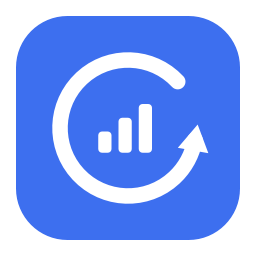

# Ads Recovery for Meta Ads Manager in Safari

A free macOS menu bar app by [PAD team](https://pad.team/) for the times Meta Ads Manager gets stuck on **Loading your ad account**. It recognizes that initial loading screen and can reload the page from origin.

[Download 0.1.0 beta](https://github.com/grigand96-hash/ads-recovery/releases/tag/v0.1.0) · [Product page](https://pad.team/en/tools/ads-recovery/) · [Changelog](CHANGELOG.md) · [Report a bug](https://github.com/grigand96-hash/ads-recovery/issues/new?template=bug_report.yml)

macOS 14+ · Apple Silicon and Intel · English interface · Free · Open-source code


## Who it is for

Media buyers, performance marketers, app founders, and agency teams who manage Meta campaigns in Safari on a Mac. If the account stays on its initial loading screen, Ads Recovery provides a visible status and a controlled way to request a reload. There is no account to create and no Meta login to share with the app.

This is a standalone Mac app, not a Safari extension. It stays in the menu bar and uses macOS interface access to inspect the active Safari window. It does not change campaign budgets, publish ads, or bypass account restrictions.

**Experimental beta.** Manual reload and detection of the loaded interface were verified on a local Mac. Automatic recovery from a second real-world hang has not yet been verified. This is not a fix for every Meta or Safari issue, and it is not affiliated with Meta or Apple.

## What you get

- A three-step introduction in English, with an explanation of the macOS permission.
- A menu bar icon, current status, manual recovery, pause, and a short local activity history.
- Automatic recovery as an optional experimental mode, off at every launch.
- A native AppKit / SwiftUI interface using system fonts. No embedded browser or third-party runtime.

## Download and install

1. Download **Ads-Recovery-macOS.zip** from the [0.1.0 release](https://github.com/grigand96-hash/ads-recovery/releases/tag/v0.1.0).
2. Unzip it and move **Ads Recovery.app** to **Applications**. Keep one installed copy.
3. Open the app. Because this beta is not notarized, macOS may block the first launch. If you choose to trust this download, follow [Apple's Open Anyway instructions](https://support.apple.com/en-gb/102445) in Privacy & Security. Do not disable Gatekeeper globally.
4. Follow **Welcome → Access → Ready**. Allow the requested macOS permission, then open Ads Manager in Safari. You can reopen these instructions with **Setup guide** in the header.

The release includes `SHA256SUMS.txt` to check download integrity. A matching checksum does not replace Apple notarization. Installation through the normal downloaded-file security flow on a clean Mac remains unverified.

## What it can and cannot recover

The current detector looks for the English initial loading message, rather than treating every slow page as broken. Manual recovery asks you to save edits first. Automatic recovery is optional and starts off: it waits 60 seconds and allows at most one attempt per 30 minutes.

It will not fix Meta outages, disabled accounts, missing permissions, login challenges, network failures, or every blank-page issue. Unknown page states are left alone. The underlying cause of the original Safari loading failure has not been conclusively established.

## Build

Requires macOS and Apple Command Line Tools or Xcode. Use Xcode 26 or newer to include native Liquid Glass; older compilers build the material fallback. The deployment target is macOS 14. Current live testing was on Apple Silicon with macOS 27.0.1 and Safari 27.0.1; older systems and Intel hardware still need testing.

```sh
bash Scripts/build.sh
```

The script runs the detector tests, generates the icons, compiles Apple Silicon and Intel slices, packages `build/Ads Recovery.app`, and produces `build/Ads-Recovery-macOS.zip` with `build/SHA256SUMS.txt`.

For an Apple Silicon-only development build:

```sh
ARCHS=arm64 bash Scripts/build.sh
```

No paid Apple Developer account is required for these builds. The app uses an **ad-hoc signature**, not an Apple Developer ID signature, and it is not notarized. A downloaded build may require explicit approval in macOS Privacy & Security. Managed Macs may disallow this. Never disable Gatekeeper globally to install this app. [Apple's explanation](https://support.apple.com/en-gb/102445).

## GitHub builds

The workflow runs on pushes to `main`, version tags, pull requests, and manual dispatch. It uploads a ZIP and checksum to the Actions run. It does not automatically publish a GitHub Release, modify the repository, or require signing secrets. Reviewed releases are published separately with the verified ZIP and checksum. Downloaded-build installation still needs testing on a clean Mac.

## First run

1. Move the app to Applications, then open it and follow the introduction. **Setup guide** in the header reopens it at any time.
2. Allow Ads Recovery under **Privacy & Security → Device Control and Data Access**. Older macOS versions call this **Accessibility**. The introduction can also be skipped to inspect the app without granting access.
3. Open Ads Manager in Safari. The app checks only while Safari is the foreground app.
4. Use **Recover Ads Manager…** for a manual reload after saving edits. To pause all background checks, turn off **Monitor Safari** or choose pause from the menu bar.

Closing the window leaves the menu bar app running. Quit from its menu to stop it completely. Login-at-startup is not installed. Rebuilding an ad-hoc-signed app may invalidate its macOS permission; remove the old Ads Recovery permission entry and add the current build if needed, even if the old switch is still on. The setup guide includes a button to reveal the current copy in Finder. Permission changes are detected automatically.

## How automatic recovery works

The detector currently supports only the English text **Loading your ad account** on an HTTPS Ads Manager URL at `adsmanager.facebook.com`, `business.facebook.com`, or `www.facebook.com`.

It requires 60 seconds of consecutive observations of that screen, a complete bounded accessibility scan with no form controls, and 10 seconds without recent typing, clicks, or scrolling. Before sending Option–Command–R, it checks the process, window, URL, page object, and state again. An automatic attempt is allowed at most once per 30 minutes across the app, including after restart.

Unknown states and incomplete scans do not authorize automatic reload. A detected table means the interface appeared; it does not prove the campaign data is complete. Sending a keyboard shortcut cannot atomically target a particular Safari tab, so a small tab-switch race remains. Treat automatic mode as experimental.

## Privacy

The macOS permission is broad; the app itself restricts inspection and control to Safari. It reads the foreground page URL to check its scope and temporarily reads interface elements on supported pages. It does not read browser cookies or credentials, or persist page URLs, account IDs, or page text.

Optional diagnostics are **off by default** and require a separate consent dialog. Recovery works without sharing. With consent, the app sends new technical events over HTTPS to `https://padteam.pro/ads-recovery/v1/events`, operated by PAD team. The closed schema contains app version, macOS major/minor version, processor architecture, state categories, check timings, reload method, and outcome. No account IDs, URLs, page text, ad data, cookies, credentials, screenshots, browsing history, or persistent user/device identifiers are included.

The app keeps at most 50 pending events in memory, sends about once a minute, and discards failed batches. It does not send cookies, follow redirects, or maintain disk logs. Turning sharing off cancels requests and clears pending events; a request already received cannot be recalled. The server immediately aggregates events into daily totals, retained for at most 30 calendar days. There is no per-user history to retrieve or delete. The endpoint disables access/error logging and does not forward client headers. IP addresses are necessarily visible during the network connection and temporarily used for rate limiting; hosting and network providers may process connection metadata.

Use **Privacy & diagnostics** in onboarding or the dashboard to review the fields, preview the pending JSON, and change consent. Collection begins only after consent; no earlier history is uploaded. Ingestion is unauthenticated and rate-limited, so these totals are best-effort observations, not verified product analytics or unique-user counts. An interface appearing after reload is not proof of complete ad data. A missing outcome can mean the user switched away or quit.

The event list lives in memory and contains generic status messages only. UserDefaults stores onboarding completion, the diagnostic consent version, and the time of the last recovery attempt. The agency link opens pad.team in the browser only when clicked; the website has its own privacy policy.

## Design

The light gray, ink, and blue palette follows [PAD team's website](https://pad.team/) and its tools section. The app uses the macOS system font rather than redistributing the website's Suisse Intl font. On macOS 26 and newer, the header, footer, and action buttons use native Liquid Glass. Older systems use a material fallback. Reduce Transparency uses solid surfaces. The application and menu icons are drawn from code in `Scripts/GenerateIcons.swift`.

Source code: MIT. PAD team branding and mascot are excluded from that license. The project contains no HAR files, browser profiles, or private account diagnostics.

## Versions

The first public beta is **0.1.0**. `VERSION` is the source of truth for the app and build number. Update it with `CHANGELOG.md` for each release, then tag the same commit as `v0.1.0` (or the next version). Tag builds fail if the tag does not match `VERSION`. Patch versions cover fixes, minor versions add features, and 1.0 is reserved for a tested stable release.

See `Server/README.md` for operating the separate diagnostic receiver.

## Troubleshooting and feedback

**Access is enabled, but the app still asks for it:** macOS can retain a permission entry for an older ad-hoc-signed build. Remove only the old Ads Recovery entry and add the installed copy again. The setup guide can reveal the correct copy in Finder. The app checks for permission changes automatically.

**The status says Waiting for Safari:** checks run only while Safari is the active app. Switching to another app pauses page inspection. The recent activity list keeps the last result.

**The status says Waiting for Ads Manager:** select the Ads Manager tab. Other sites are outside the detector's scope.

**A reload has no confirmed result:** switching tabs, leaving Safari, or quitting can interrupt observation. A reported interface only means a table appeared; it does not establish that all campaign data loaded.

[Open an issue](https://github.com/grigand96-hash/ads-recovery/issues) with your app, macOS, and Safari versions and the generic status you saw. Do not post account IDs, business IDs, campaign data, browser profiles, HAR files, cookies, or credentials. Optional in-app diagnostics are off by default; see Privacy above for the exact fields and retention.

## About PAD team

We build tools alongside our work in mobile app marketing. [PAD team](https://pad.team/en/) helps app teams with paid acquisition, creative, and growth. Explore our [marketing tools](https://pad.team/en/tools/).
