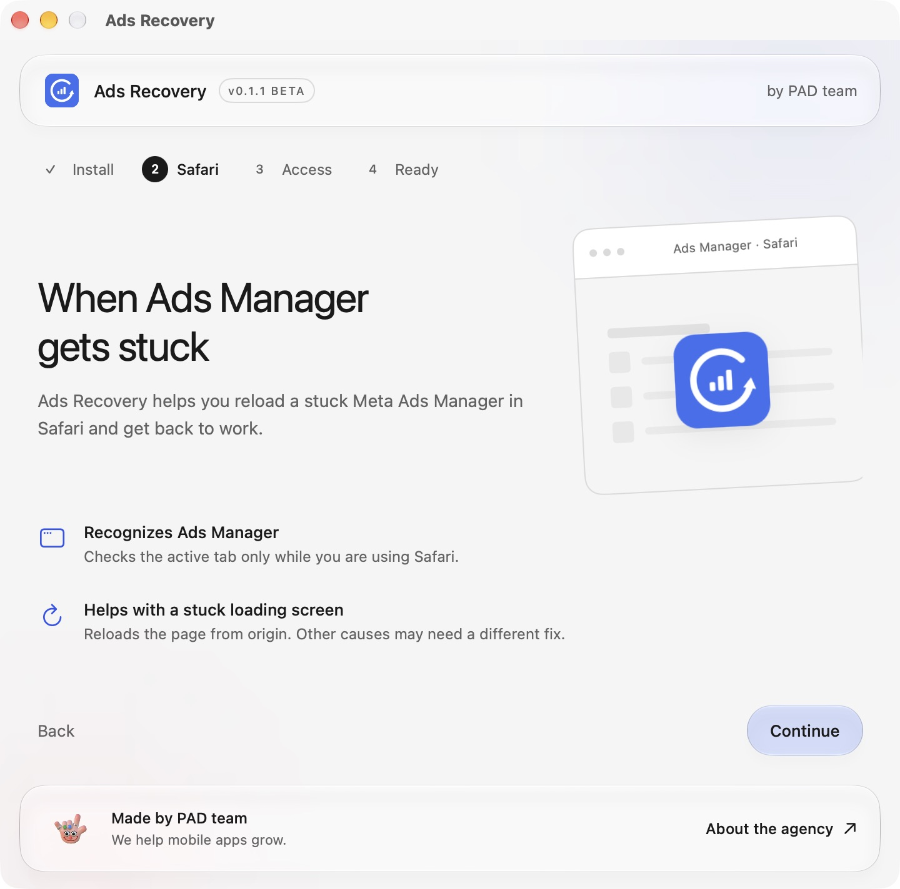

# Install and set up Ads Recovery on your Mac

[Download Ads Recovery 0.1.0](https://github.com/grigand96-hash/ads-recovery/releases/download/v0.1.0/Ads-Recovery-macOS.zip) · [About the app](../README.md) · [Website guide](https://pad.team/en/tools/ads-recovery/#setup)

You need a Mac running macOS 14 or later and Safari. The download includes both Apple Silicon and Intel versions. No Terminal commands, developer tools, or GitHub account are needed.

Already moved the app to Applications? Start with [Open the app](#open-the-app).

## Download and move to Applications

1. Click **Download Ads Recovery 0.1.0** above. The file is named **Ads-Recovery-macOS.zip**. On the release page, choose this file under **Assets**, not either “Source code” download.
2. Open **Finder → Downloads**. Double-click the ZIP if Safari has not already unpacked it.
3. Drag **Ads Recovery.app** into **Applications** in Finder's sidebar. If Finder hides file extensions, it may appear as **Ads Recovery**.
4. Open the copy in Applications. Keep just one installed copy so macOS can assign permission to the right app.

## Open the app

This beta is not notarized by Apple, so macOS may stop it from opening the first time.

If you trust this download, try opening it once, then go to **System Settings → Privacy & Security**. Find the message about Ads Recovery, choose **Open Anyway**, and confirm the next prompt. macOS may ask for your password or Touch ID. See [Apple's first-launch guide](https://support.apple.com/en-gb/102445) if your screen differs.

Do not turn off Gatekeeper for the whole Mac. If macOS reports malware or a damaged app, stop rather than bypassing that warning. A work-managed Mac may require help from your administrator.

## Allow access to Safari

1. In Ads Recovery, follow **Welcome → Access → Ready**. If you see the main window instead, click **Setup guide** at the top.
2. On the Access screen, use the button that opens system settings.
3. Turn on **Ads Recovery** under **Privacy & Security → Device Control and Data Access**. Older macOS versions call this **Accessibility**. Approve the system prompt if asked.
4. Return to Ads Recovery. It should show **Access granted**. Click **Check access** if needed, then continue to **Ready** and click **Get started**.

This is a broad macOS permission to read and control interfaces. Ads Recovery's code limits its checks to the active Safari window and supported Ads Manager pages. It needs this permission to recognize the loading screen and request a reload.

## Try your first recovery

1. Open your Meta Ads Manager tab in Safari. Keep Safari at the front while the app checks the page.
2. If Ads Manager loads normally, there is nothing to recover.
3. If it stays on **Loading your ad account**, save any unsaved campaign edits before reloading.
4. Open Ads Recovery from its circular-arrow icon in the macOS menu bar. Choose **Recover Ads Manager…** and confirm **Reload**.
5. Let the app return to Safari. Stay on that Ads Manager tab while the page reloads, then check that your campaign data has appeared.

The app requests Safari's **Reload Page From Origin** command. A visible campaign table means the interface appeared; check the data yourself before continuing work. If a reload does not help, avoid repeating it indefinitely. Account restrictions, login challenges, and service outages need a different solution.

## Choose what runs in the background

- **Monitor Safari** checks supported pages while Safari is the active app. Turn it off to pause checks.
- **Automatic recovery** is experimental and off at every launch. If enabled, it waits for 60 seconds of the supported loading screen and attempts recovery at most once per 30 minutes. The full automatic sequence on a repeated real hang still needs testing.
- **Privacy & diagnostics** lets you choose whether to share technical events with PAD team. Sharing starts off. Leave it off to keep recovery local; the app works either way. [See the exact data and retention rules](../README.md#privacy).

Closing the window leaves the app in the menu bar. Use its menu to quit completely. The app does not add itself to login items, so open it from Applications when you want to use it.

## If something looks wrong

### Access is on, but the app still asks for it

macOS may remember permission for an older build. In Ads Recovery, open **Setup guide** and use **Show this copy in Finder** on the Access screen to locate the running app. In the macOS permission list, remove only the old **Ads Recovery** entry with the minus button. Use the plus button to add the current copy from Applications, turn it on, and approve the system prompt. Return to the app; permission status updates automatically.

### The app says Waiting for Safari

Safari must be the active app. Switch back to Safari and leave the Ads Manager tab selected. Opening another app pauses page inspection, so this status by itself does not mean setup failed.

### The app says Waiting for Ads Manager

Select the actual Ads Manager tab in Safari. Other websites and unrelated Meta pages are outside the detector's scope.

### The introduction did not appear

Click **Setup guide** at the top of the Ads Recovery window. You can revisit it at any time.

### Ads Manager is blank or uses another language

The current detector recognizes the English **Loading your ad account** message. It does not automatically recover other loading messages, unknown page states, or every blank page.

### It still does not work

[Report a problem on GitHub](https://github.com/grigand96-hash/ads-recovery/issues/new?template=bug_report.yml). Include your app, macOS, and Safari versions and the status you saw. Leave out account IDs, campaign data, cookies, credentials, browser profiles, and HAR files.

Version 0.1.0 is an experimental beta. Intel, older macOS versions, and the downloaded-file security flow on a clean Mac still need testing. Ads Recovery is an independent PAD team app, with no affiliation to Meta or Apple.
